<div align="center">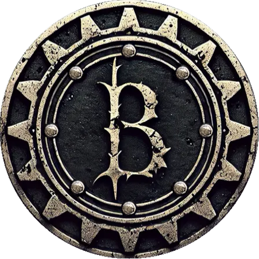</div>
<h1 align="center">Bloodborne Save Editor Enhanced</h1>
<p align="center">
  <a href="https://github.com/Rival99900/Bloodborne-save-editor-enhanced/releases"></a>
  <a href="https://github.com/Rival99900/Bloodborne-save-editor-enhanced/releases/latest"></a>
  <a href="https://github.com/Rival99900/Bloodborne-save-editor-enhanced/releases"></a>
  
  
  <a href="LICENSE"></a>
</p>

<p align="center"><em>A passion-driven modernisation of the original Bloodborne save editor: clearer, safer and more comfortable advanced save editing.</em></p>

> [!IMPORTANT]
> **To use this save editor on PlayStation you first need to decrypt your Bloodborne save.** If you don't know how, see the [wiki of the original project](https://github.com/Noxde/Bloodborne-save-editor/wiki/How-to-decrypt-a-save).

> [!NOTE]
> If you use this with **shadPS4**, saves are located in `shadPS4/user/savedata/1/GAMEID/SPRJ0005/`.
> Depending on your copy of Bloodborne, `GAMEID` is one of `CUSA00900`, `CUSA03173`, `CUSA00207` or `CUSA01363`.

**Bloodborne Save Editor Enhanced** builds on the [Bloodborne Save Editor by Noxde](https://github.com/Noxde/Bloodborne-save-editor) with a cleaner interface, safer save workflows, complete Gem and Rune editing and many quality-of-life tools. See [Credits](#credits-and-license).

## Contents

- [What's new in v0.7.5](#whats-new-in-v075)
- [Features](#features)
- [Download](#download)
- [Save safety](#save-safety)
- [Keyboard shortcuts](#keyboard-shortcuts)
- [Automatic updates](#automatic-updates)
- [Development](#development)
- [Credits and license](#credits-and-license)

## What's new in v0.7.5

- **Bulk actions**: open every closed Gem slot of the weapons (shape and number of slots, up to 5), refill Blood Vials and Quicksilver Bullets, turn **infinite Blood Vials and Quicksilver Bullets** on or off, and the +10 action now leaves the Loch Shield alone (a reinforced one disappears in game).
- **Export / Import** of the Inventory and the Storage as JSON or CSV: choose what to import (everything, items, weapons, armor, Gems, Runes) and keep or drop the Gems of weapons and armor. The import only adds, shows its progress, and one Undo cancels it.
- **Gem finder** (Tools): search every Gem and Rune by effect, in the Inventory, the Storage and on equipped weapons, with duplicate detection.
- **Save comparison** (Tools) now covers stats, character, bosses, Inventory and Storage, in addition to the flag region.
- **Lamp control** in Character, and **Teleport** is only written when you select **Confirm**.
- Much faster save loading and editing, long operations no longer freeze the window, visible keyboard focus and arrow-key navigation in the Inventory/Storage list.
- Every change is listed in the [CHANGELOG](CHANGELOG.md); release notes: [v0.7.5](.github/release-notes/v0.7.5.md).

> [!TIP]
> Edits stay in memory until you select **Save changes** (`Ctrl+S`). The **Change log** in the header lets you review, undo and redo them first.

## Features

<details>
<summary><b>Overview of the editor</b></summary>
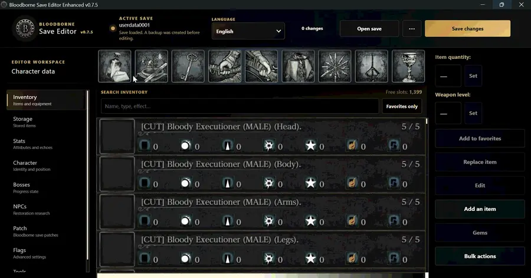
</details>

### Inventory and Storage

- Automatic backup when a save is opened, filters, text and effect search, favorites and live free-slot counters.
- Add compatible items, keys, chalices, weapons, armor, Gems and Runes; weapon and armor replacement keeps their slot data.

<details>
<summary>Change items amount.</summary>
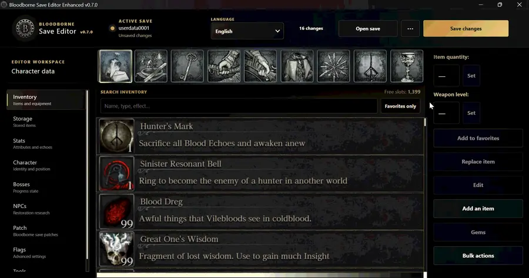
</details>
<details>
<summary>Add items, weapons and armor.</summary>
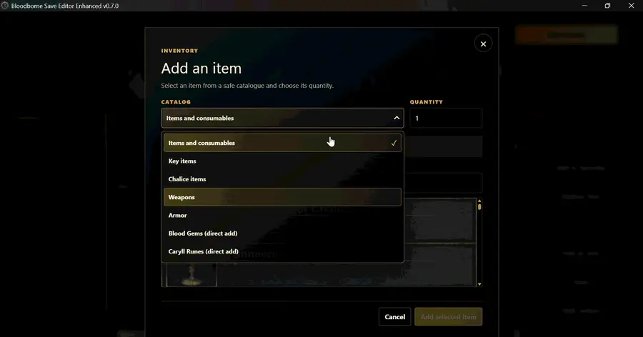
</details>
<details>
<summary>Transform items, weapons and armor.</summary>
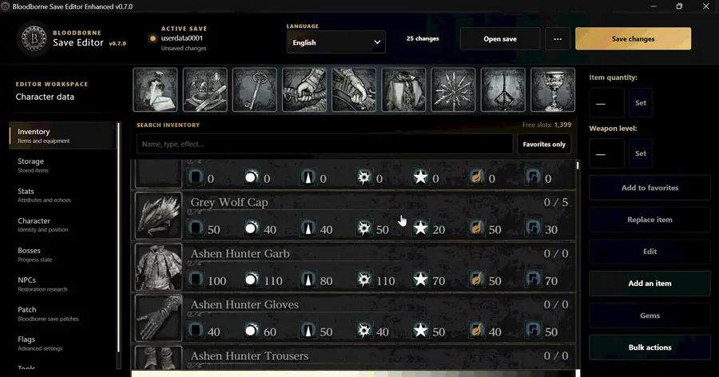
</details>
<details>
<summary>Favorites and search.</summary>
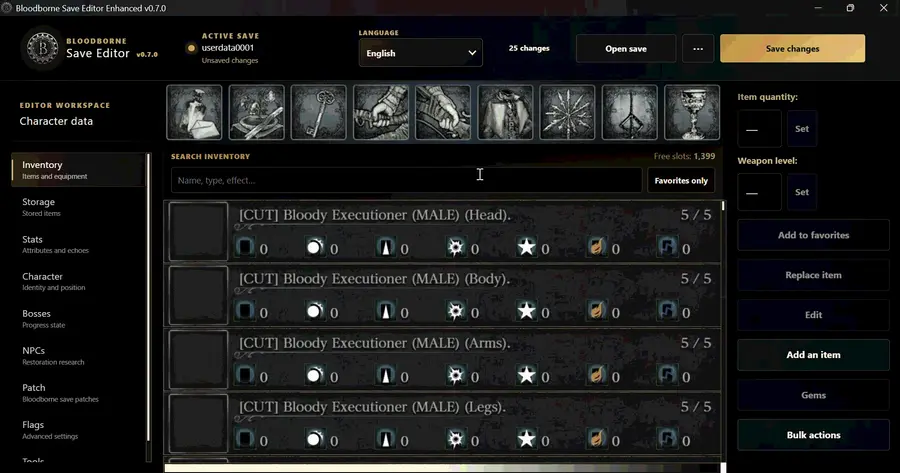
</details>
<details>
<summary>Bulk actions: move Gems/Runes, weapons to +10, open Gem slots, refill consumables, export and import.</summary>
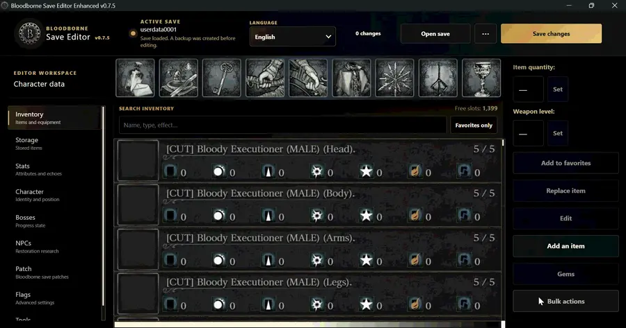
</details>

### Gems and Runes

- Edit the shape, the rating and the six effects of any Gem or Rune, with validated combinations.
- **Gem Forge** and **Rune Forge**: built-in presets, a six-effect custom builder and a shared **My presets** library with JSON import/export.

<details>
<summary>Edit Gems and Runes.</summary>
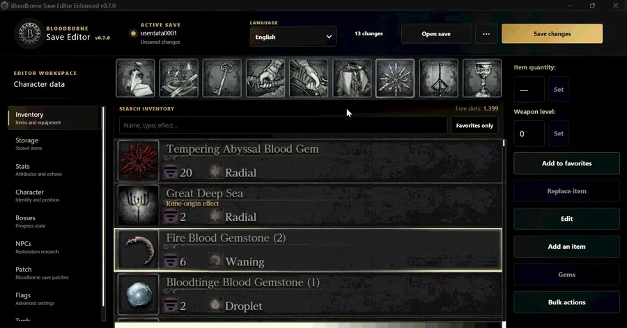
</details>
<details>
<summary>Gem Forge and Rune Forge.</summary>
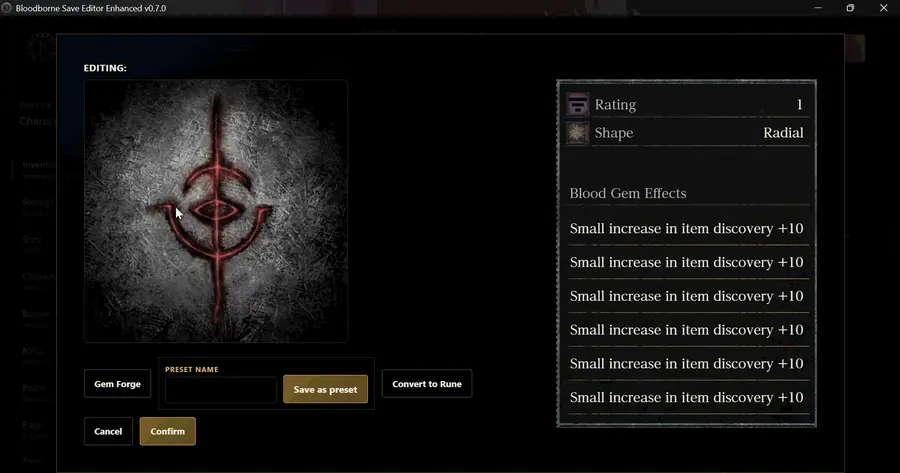
</details>
<details>
<summary>Edit weapon and armor Gem slots.</summary>
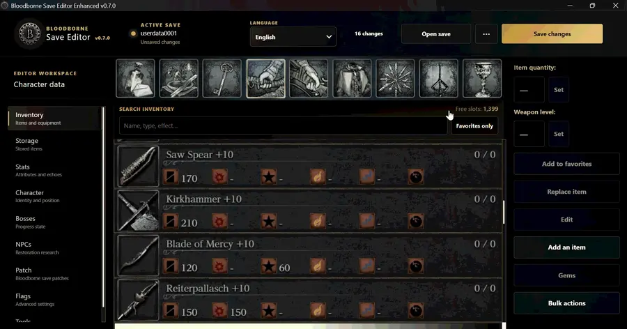
</details>

### Character and progression

<details>
<summary>Change character attributes, with presets and a consistency check.</summary>
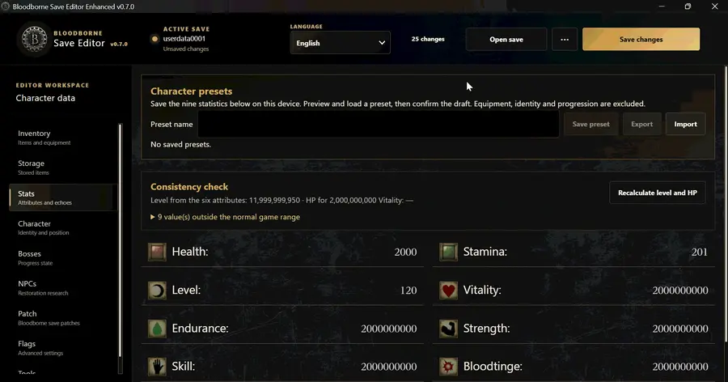
</details>
<details>
<summary>Change Blood Echoes, Insight, gender, origin, voice and position.</summary>
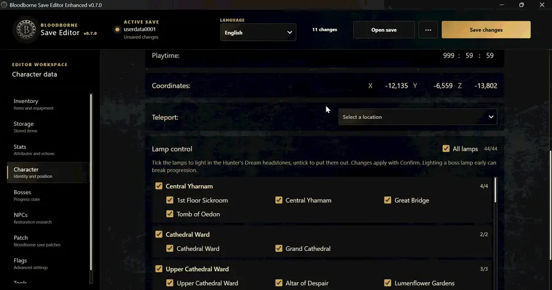
</details>
<details>
<summary>Teleport to any lamp and turn lamps on or off.</summary>
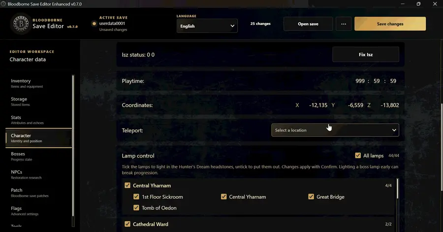
</details>
<details>
<summary>Kill or revive bosses.</summary>
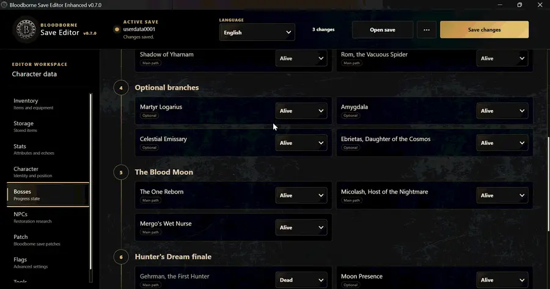
</details>
<details>
<summary>Set flags.</summary>
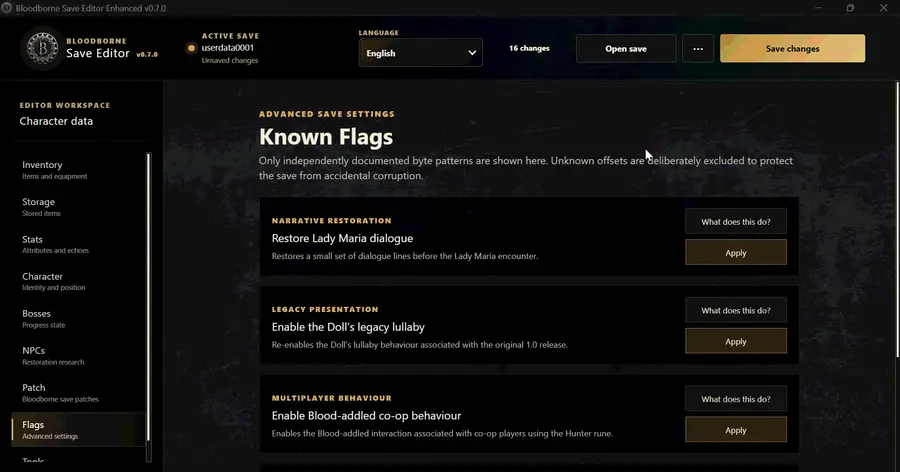
</details>
<details>
<summary>NPC research.</summary>
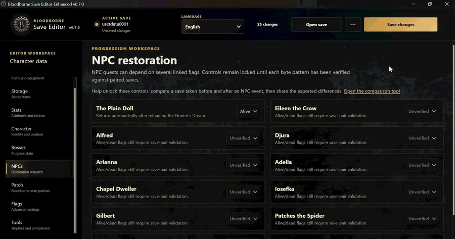
</details>

### Tools, patches and interface

<details>
<summary>Tools: trophy assistant, Gem finder and save comparison.</summary>
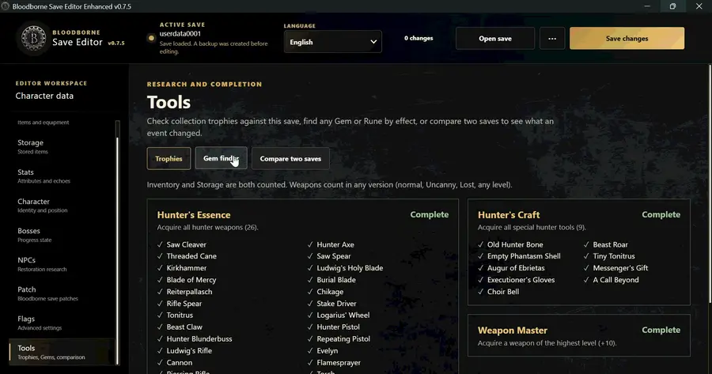
</details>
<details>
<summary>Offline Apollo patches for CUSA00207 and CUSA00900, with byte previews.</summary>
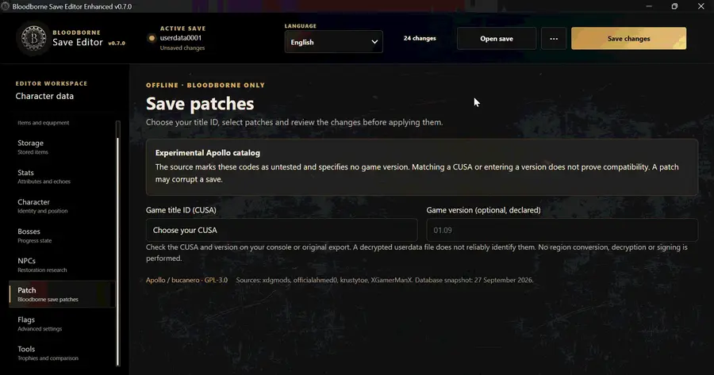
</details>
<details>
<summary>Change log with Undo and Redo.</summary>
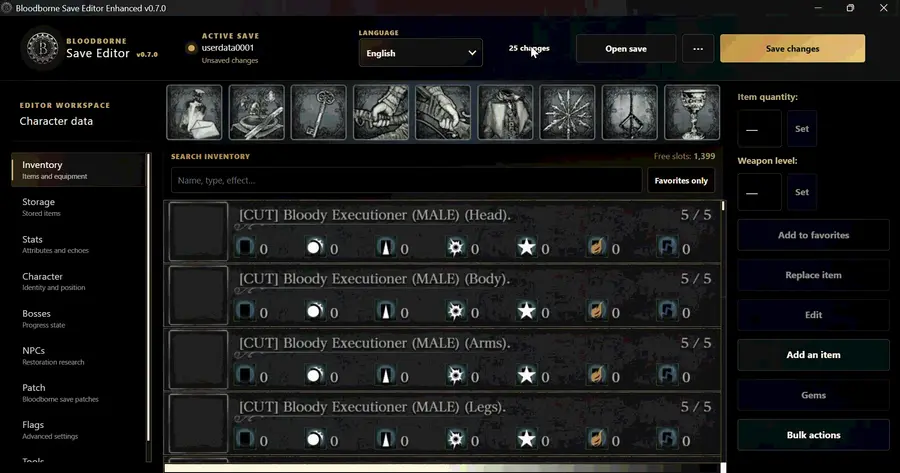
</details>
<details>
<summary>14 interface languages.</summary>
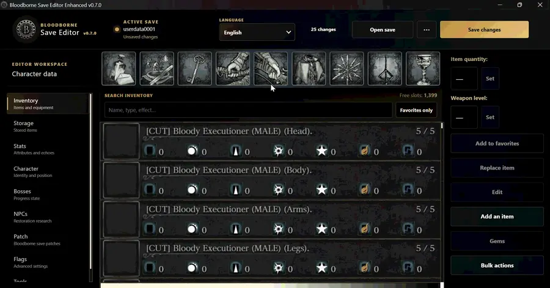
</details>

| Area | What is included |
| --- | --- |
| **PS4 / PS5 over FTP** | GoldHEN on PS4 (port 2121) or etaHEN on PS5 (port 1337): open, send back (checked by reading the file back), import or delete a save. The console's version is kept locally before any replacement. |
| **File menu** | Recent saves, drag and drop, keyboard shortcuts (`F1`) and a backup history of dated copies in `<file>.backups/`. |
| **Apollo compatibility** | Detects the LF-to-CRLF expansion seen in some decrypted transfers, repairs the in-memory copy and keeps the untouched source in `.bak`. |
| **Languages** | English, French, Italian, German, Spanish, Dutch, Polish, Russian, Danish, Norwegian Bokmål, Finnish, Swedish, Turkish and Portuguese (Portugal). |

## Download

Download the latest package from the [Releases page](https://github.com/Rival99900/Bloodborne-save-editor-enhanced/releases): a **Windows x64 installer** (`.exe` and `.msi`), an **Ubuntu/Linux x64 AppImage**, signed updater metadata and a `SHA256SUMS.txt` checksum manifest.

| Step | What to do |
| --- | --- |
| **1. Prepare your save** | Use an already decrypted Bloodborne save and make an independent copy before editing. |
| **2. Install** | Run the Windows installer or the AppImage from the Releases page. |
| **3. Open** | Select **Open save** or press `Ctrl+O`. |
| **4. Edit carefully** | Review every change in the editor before selecting **Confirm**. |
| **5. Save and test** | Press `Ctrl+S`, keep the automatic `.bak` backup, and test the save in game. |

## Save safety

The editor creates a `.bak` backup when a save is opened and dated copies in `<file>.backups/`. Composite operations (bulk actions, imports, additions) are checked on a copy first: if one step is refused, the open save is left unchanged.

> [!WARNING]
> This application edits save data. Keep the `.bak` backup and an independent copy of your decrypted save until you have checked the result in game. Avoid editing saves intended for online play. You remain responsible for every modification made to your save.

## Keyboard shortcuts

| Action | Shortcut or control |
| --- | --- |
| Open a decrypted save | `Ctrl+O` |
| Save changes | `Ctrl+S` |
| Undo / Redo an in-memory change | `Ctrl+Z` / `Ctrl+Y` or `Ctrl+Shift+Z` |
| Show every shortcut | `F1` |
| Move in the Inventory/Storage list | Focus the list, then `↑` `↓` `Page Up` `Page Down` `Home` `End` |
| Close a dialog | `Escape`, the close button, or a click outside the window |
| Zoom the interface | `Ctrl` + `+`, `Ctrl` + `-`, or `Ctrl` + `0` |

## Automatic updates

The desktop application checks the signed `latest.json` manifest of the `main` branch at start-up. When a newer version is available it shows an update dialog, downloads the package, verifies its Tauri signature with the public key packaged in the application, installs it and restarts.

<details>
<summary>How release summaries and signatures are produced</summary>

Update-dialog summaries live in `src/i18n/releaseSummaries.json`: edit `default` for the reusable sentence, or add a complete language map under `versions["x.y.z"]` (without the `v` prefix). The release workflow writes these translations to `localized_notes` in the updater manifest and keeps `notes` as plain English for older clients.

The workflow builds the Windows NSIS and MSI installers and the Ubuntu/Linux AppImage, their `.sig` files and a combined `latest.json` manifest that contains the **signature content** (required by Tauri v2). `SHA256SUMS.txt` is published for manual checks.

</details>

> [!CAUTION]
> Never put `TAURI_SIGNING_PRIVATE_KEY`, `TAURI_SIGNING_PRIVATE_KEY_PASSWORD` or `RELEASE_TOKEN` in the source tree, an issue, a release note or a log. They are read only inside the GitHub Actions runner.

## Development

This project uses **Tauri v2**, **React** and **Vite**.

```bash
npm install
npm run lint       # ESLint
npm test           # Vitest
npm run validate   # project checks (translations, features, release notes)
npm run format     # Prettier: one property per line, nested CSS rules
npm run tauri -- build
```

```bash
cd src-tauri
cargo fmt --check
cargo clippy --all-targets -- -D warnings
cargo test --all-targets
```

<details>
<summary>Release procedure</summary>

1. Update the version in `package.json`, `src-tauri/Cargo.toml` and `src-tauri/tauri.conf.json` together, add `.github/release-notes/vX.Y.Z.md` and run `npm run changelog`.
2. Validate locally with the commands above.
3. Push to `main` with `[release]` in the commit message: the workflow reads the version from `package.json`, builds, signs and publishes the release. `[refresh]` rebuilds the assets of an existing release.

The workflow requires these repository secrets:

| Secret | Purpose |
| --- | --- |
| `TAURI_SIGNING_PRIVATE_KEY` | The complete, unmodified Tauri private signing key. |
| `TAURI_SIGNING_PRIVATE_KEY_PASSWORD` | The password associated with the signing key. |
| `RELEASE_TOKEN` | A fine-grained personal token with Contents read/write access, used to publish releases. |

</details>

## Credits and license

This project is distributed under the [GPL-3.0](LICENSE). It is derived from the original work by [Noxde](https://github.com/Noxde/Bloodborne-save-editor) and continues under the same open-source license.

> [!NOTE]
> **Thanks** to [Noxde](https://github.com/Noxde) for the original project, to [valentinoamato](https://github.com/valentinoamato) for the upstream [weapon and armor insertion method](https://github.com/Noxde/Bloodborne-save-editor/commit/84adcfaba099d4d54ba98ae9c069fe77228706e9) and its [GA-slot correction](https://github.com/Noxde/Bloodborne-save-editor/commit/f562c2893a4efdf3b281dc21dc89845c080d8d34), and to [Argagaes](https://github.com/Argagaes) for the [lamp table](https://github.com/Noxde/Bloodborne-save-editor/pull/67) used by **Character → Lamp control**. The Patch catalogs come from [Apollo](src-tauri/resources/patches/NOTICE.md).
